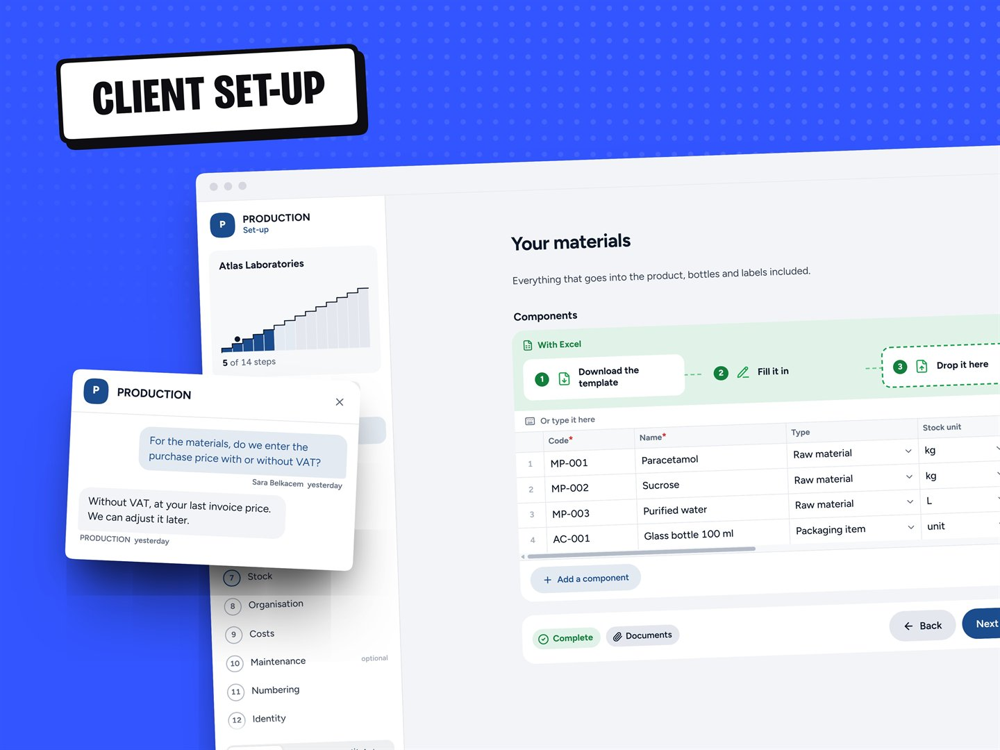
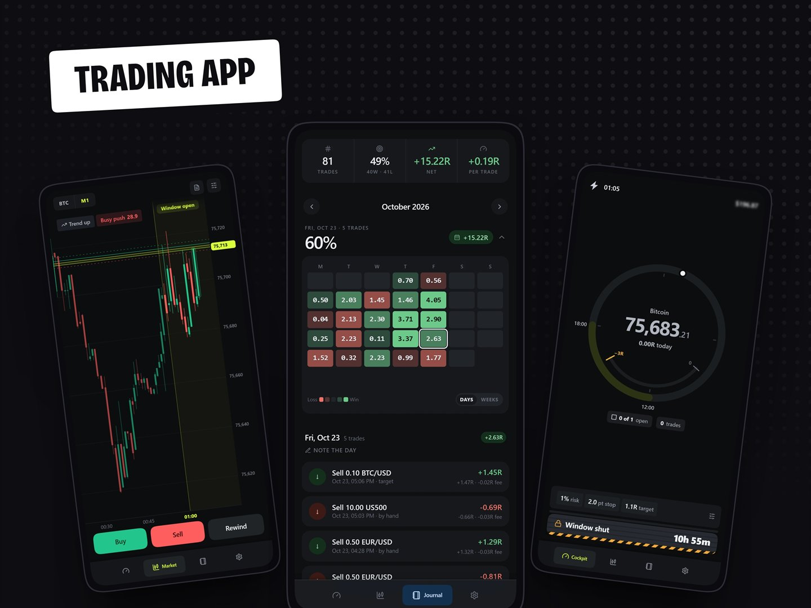

<picture>
  <source media="(prefers-color-scheme: dark)" srcset="assets/banner-dark.png">
  
</picture>

  

I'm **Idir**, a full-stack engineer. Under the name **Qwarters** I design and build custom software end to end: business systems, web apps, desktop and mobile.

  &nbsp;
  &nbsp;
  &nbsp;
  

 

## Recent work

<table>
  <tr>
    <td width="50%" valign="top">
      
      <h3>Onboard</h3>
      
Client set-up, in one link. Each new client fills in their set-up step by step, and the team gets a file ready to plug in.

    </td>
    <td width="50%" valign="top">
      
      <h3>Scalp</h3>
      
A trading app built to say no. Any market, on the web or a phone. Practise on any past day, and keep every tick.

    </td>
  </tr>
</table>

Both built for private clients. The full stories are on [qwarters.dev/work](https://qwarters.dev/work).

 

## What I build with

